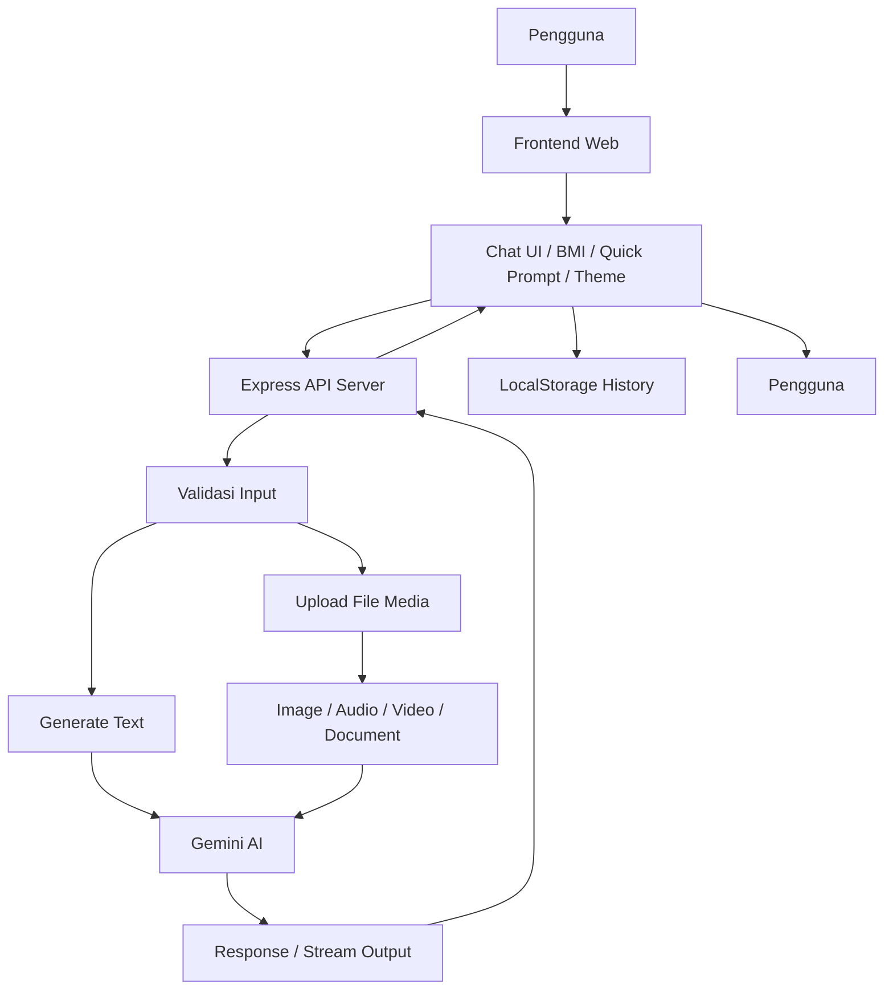

# Diagram Alur Proyek FitCoach AI

## Penjelasan Singkat

- Pengguna berinteraksi dengan frontend.
- Frontend mengirim request ke server Express.
- Server melakukan validasi input dan mengelola upload file.
- Data dikirim ke model Gemini untuk diproses.
- Hasil dikembalikan ke client dalam format chat biasa atau streaming.
- Riwayat chat disimpan di browser melalui `localStorage`.

## Tujuan Diagram

Diagram ini membantu memahami aliran data secara cepat, mulai dari input pengguna hingga hasil dari AI. Ini cocok untuk portofolio, presentasi, atau dokumentasi teknis.
